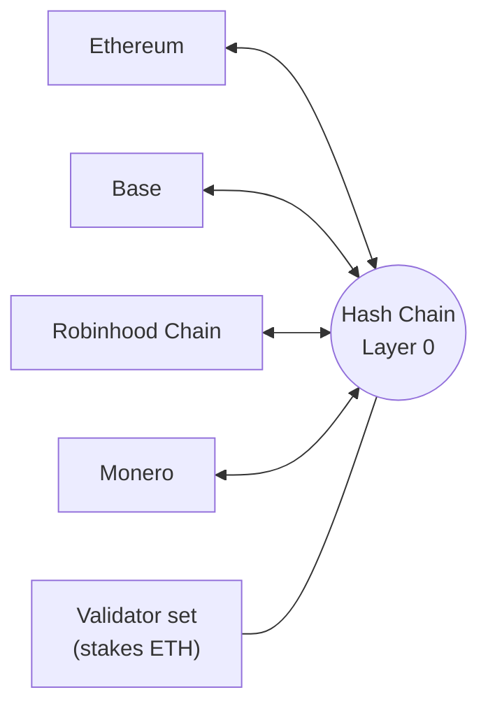

# Hash Chain

**Go in public. Come out private.**

The privacy Layer 0.

[Website](https://hashchain.network) &nbsp;|&nbsp; [X](https://x.com/hashchainL0) &nbsp;|&nbsp; [Protocol spec](https://github.com/HashChainL0/protocol-spec) &nbsp;|&nbsp; [Brand kit](https://github.com/HashChainL0/brand-kit)

> **Status: pre-launch, spec stage.** Everything here is a draft and may change. Nothing is deployed, audited or available to use yet.

## What is Hash Chain

Hash Chain is a privacy-first Layer 0 network. It has its own validators, and privacy is built into the base layer, so accounts, payments, swaps, assets and apps are private by default, settle in moments, and connect to Ethereum, Base, Robinhood Chain and Monero. It is the private base layer for onchain finance.

## What lives on Hash Chain

1. **Private accounts.** Balances and history are hidden by default. One account holds any connected asset.
2. **Private payments.** Private transfers of ETH and stablecoins, payment links, batch payouts and merchant checkout.
3. **Private swaps.** A native exchange layer where trades, sizes and wallets are not visible, so no front-running or copy-trading. Includes native atomic swaps with Monero.
4. **Private assets.** Issue and hold tokenized assets, such as stablecoins and tokenized stocks, with private balances and transfer rules enforced by proofs.
5. **Private apps.** Deploy contracts whose inputs and state stay hidden. SDK and APIs for wallets, fintechs and apps.
6. **Proofs, not exposure.** View keys and credentials for audits, compliance checks and taxes. Private, not shady.
7. **Connected to everything.** Ethereum, Base, Robinhood Chain and Monero connect in and out.

## Network

- **Its own validators.** An independent validator set secures the network by staking ETH.
- **Proofs, not trust in contents.** Validators verify zero-knowledge proofs without seeing amounts or parties.
- **Fast deterministic finality** is the design target.
- **Fees in ETH.** No token is required to use the network.
- **Connections.** Ethereum, Base and Robinhood Chain connect through bridge contracts verified by the validator set, plus a liquidity network for fast transfers. Monero connects through trustless atomic swaps.

## Who it is for

- **People** who want to stop being tracked and pay and hold privately.
- **Traders** who want to trade without being front-run or copied.
- **Businesses and fintechs** that pay suppliers and staff, run treasury and accept payments without publishing finances, and can still prove them to auditors.
- **Builders** who want private apps without inventing cryptography.
- **Monero holders** who want to reach the Ethereum world without an exchange.

## Security

The trust model, risks and open design questions are documented in the [security and trust spec](https://github.com/HashChainL0/protocol-spec/blob/main/docs/09-security-and-trust.md). To report a vulnerability, open a private security advisory on the [protocol-spec](https://github.com/HashChainL0/protocol-spec/security/advisories/new) repository.

## Links

- Website: https://hashchain.network
- X: https://x.com/hashchainL0
- Protocol spec: https://github.com/HashChainL0/protocol-spec
- Brand kit: https://github.com/HashChainL0/brand-kit
