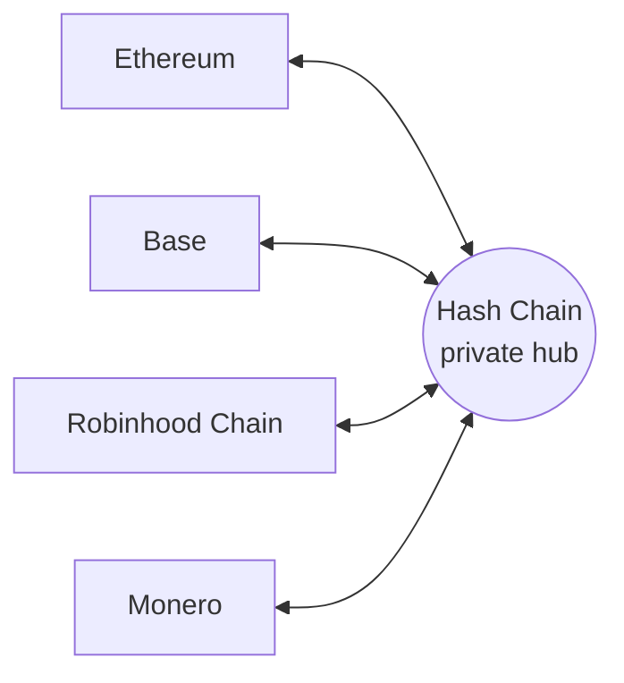

# Hash Chain

**Go in public. Come out private.**

Private routes between Ethereum, Base, Robinhood Chain and Monero.

[X](https://x.com/hashchainL0) &nbsp;|&nbsp; [Protocol spec](https://github.com/HashChainL0/protocol-spec) &nbsp;|&nbsp; [Brand kit](https://github.com/HashChainL0/brand-kit)

> **Status: pre-launch, spec stage.** Everything here is a draft and may change. Nothing is deployed, audited or available to use yet.

## What is Hash Chain

On Ethereum, Base and Robinhood Chain, every balance and every transfer is public. Anyone can look up what you hold and who you paid. Monero is private, but it lives apart from the Ethereum world, so moving value between them usually means trusting a custodian.

Hash Chain is a privacy chain that works as a private hub between these networks. You come in from a supported chain, your funds become shielded, and you leave to any supported chain. People watching the origin and the destination cannot link the two.

Technically, Hash Chain is an L3 that settles on Base and is secured by Ethereum through Base. Gas is paid in ETH.

## How it works

1. **Come in.** Deposit from Ethereum, Base or Robinhood Chain, or start a swap from Monero.
2. **Go private.** Your funds become shielded notes. Transfers inside Hash Chain hide amounts and parties.
3. **Leave anywhere.** Withdraw to any supported chain. Nothing on-chain connects your exit to your entry.

## Supported routes (planned)

| Chain | Asset | Route type |
| --- | --- | --- |
| Base | ETH, with more assets to be specified | Canonical bridge, plus fast exits through the liquidity network |
| Ethereum | ETH, with more assets to be specified | Liquidity network |
| Robinhood Chain | ETH only in v1, other assets later | Liquidity network |
| Monero | XMR and ETH | Trustless atomic swap |

## Key features

- **Shielded transfers.** Notes, nullifiers and zero-knowledge proofs hide amounts and parties.
- **Any-to-any private routes.** One hub connects every supported chain to every other.
- **Trustless Monero swaps.** XMR to ETH and back with adaptor signatures and no custodian.
- **View keys.** Share scoped, read-only, revocable visibility into your own history with an accountant or auditor. Private, not shady.
- **ETH for gas.** No new token is needed to use the chain.

## Security

The trust model, risks and open design questions are documented in the [security and trust spec](https://github.com/HashChainL0/protocol-spec/blob/main/docs/09-security-and-trust.md). To report a vulnerability, open a private security advisory on the [protocol-spec](https://github.com/HashChainL0/protocol-spec/security/advisories/new) repository.

## Links

- X: https://x.com/hashchainL0
- Protocol spec: https://github.com/HashChainL0/protocol-spec
- Brand kit: https://github.com/HashChainL0/brand-kit
